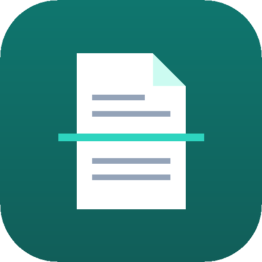
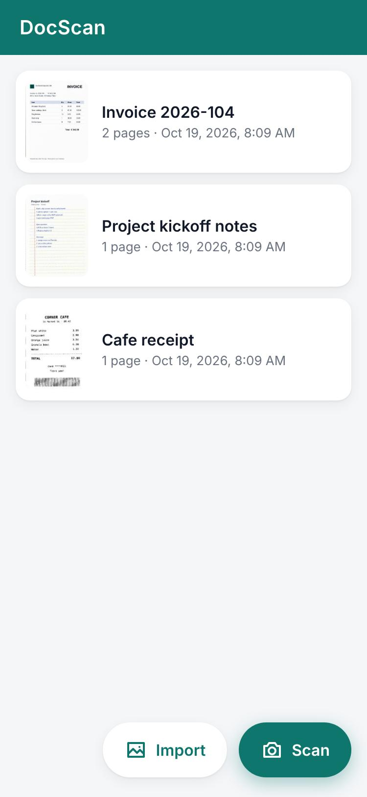
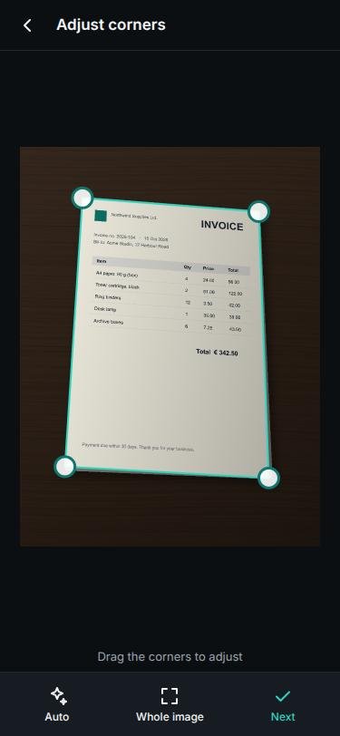
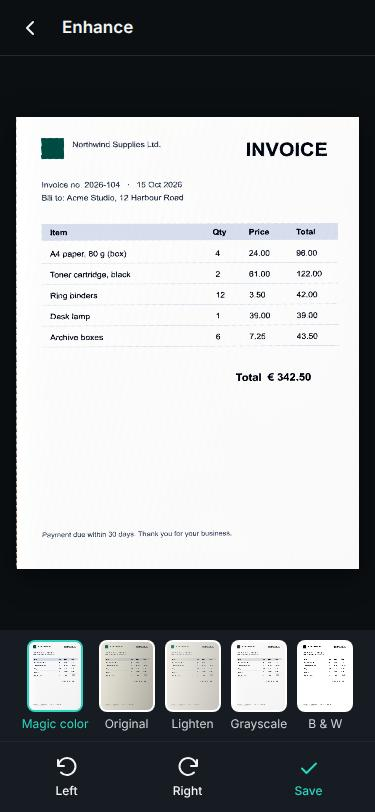
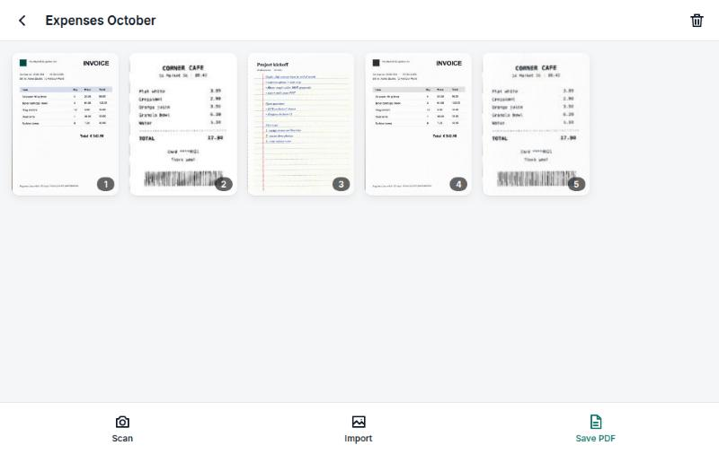
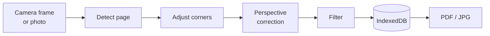

<div align="center">



# DocScan

**Scan paper documents with your camera. Straighten, clean up, and save them as PDF.**
Private by design: everything runs on your device. No account, no ads, no tracking.

[](https://github.com/Hafij-DEU/Scan/releases/latest)
[](https://github.com/Hafij-DEU/Scan/actions/workflows/windows.yml)
[](LICENSE)


[**Download**](https://github.com/Hafij-DEU/Scan/releases/latest) · [Features](#features) · [Install](#install) · [How it works](#how-it-works) · [Build](#build-from-source)

</div>

<p align="center">
  
  &nbsp;
  
  &nbsp;
  
</p>
<p align="center"><sub>Your documents · automatic page detection · straightened page with filters</sub></p>

## Features

- 📷 **Capture or import**: live camera with the page outline drawn as you aim, or import photos (several at once).
- ✂️ **Automatic page detection**: the corners snap to the page. Drag them to fine-tune, with a magnifier for precision.
- 📐 **Perspective correction**: a photo taken at an angle becomes a flat, upright page.
- ✨ **Filters**: *Magic color* removes shadows and colour casts. There are also *Lighten*, *Grayscale* and *B&W*.
- 📚 **Multi-page documents**: add, reorder, re-edit, rotate and delete pages; the original photo is kept for re-cropping.
- 📄 **Export**: one PDF per document, or a JPG per page. On Android you can also share straight to other apps.
- 🔒 **Offline and private**: scans stay in local app storage. The app makes no network requests.

<p align="center">
  
</p>

## Install

Get the files from the [latest release](https://github.com/Hafij-DEU/Scan/releases/latest).

| Platform | File | Requirements |
| --- | --- | --- |
| **Linux** | `DocScan-<version>-amd64.deb` | Debian, Ubuntu or derivatives, x86-64 |
| **Windows** | `DocScan-<version>-setup-x64.exe` (installer)<br>`DocScan-<version>-portable-x64.exe` (no install) | Windows 10 or 11, x64 |
| **Android** | `DocScan-<version>.apk` | Android 10 or newer |

### Linux

This command works from any folder. It downloads the package, then installs it; run it again with a newer version to update.

```bash
wget -O /tmp/DocScan.deb https://github.com/Hafij-DEU/Scan/releases/download/v0.1.1/DocScan-0.1.1-amd64.deb && sudo apt install /tmp/DocScan.deb
```

<details>
<summary>Installing a <code>.deb</code> you already downloaded</summary>

Give `apt` the file's full path. A bare file name is looked up as a package name and fails.

```bash
sudo apt install ~/Downloads/DocScan-0.1.1-amd64.deb
```

Some download managers save to `~/Downloads/Compressed/` instead.
</details>

To uninstall: `sudo apt remove docscan`.

### Windows

Run the installer, or start the portable exe without installing. The builds aren't code-signed yet, so SmartScreen may say *"Windows protected your PC"*. Choose **More info**, then **Run anyway**.

### Android

Open the APK on your phone and allow installs from your browser or file manager when asked. Updates install over the previous version and keep your scans.

<details>
<summary>Verify downloads</summary>

Each release has a `SHA256SUMS` file for the `.deb` and `.apk`, and GitHub shows a SHA-256 digest for every file:

```bash
sha256sum -c SHA256SUMS --ignore-missing
```

The APK signing certificate has SHA-256 `0d5accebaeb219e5012b290a87e8ad0b672f2e22f5f85d419b370abcd7d96a50`.
</details>

## How it works

All image processing is plain TypeScript running on the device. It has no OpenCV, no machine learning, and no server.



| Step | Method | Code |
| --- | --- | --- |
| Detect page | Otsu threshold, largest region with holes filled, convex hull, max-area quadrilateral. Each side must have a visible edge, so screenshots and flat scans keep the whole image. | [`detect.ts`](src/imaging/detect.ts), [`geometry.ts`](src/imaging/geometry.ts) |
| Perspective correction | 8-point homography with bilinear sampling, output up to 2480 px (about A4 at 300 dpi) | [`warp.ts`](src/imaging/warp.ts) |
| Filters | Divide by an estimated paper background (block bright-mean, dilated and smoothed), then a tone curve | [`filters.ts`](src/imaging/filters.ts) |
| PDF | Dependency-free PDF 1.4 writer, one JPEG per page | [`pdf.ts`](src/pdf.ts) |
| Storage | IndexedDB stores documents and pages, keeping originals for re-editing | [`store.ts`](src/store.ts) |

One web app (`src/`, Vite + TypeScript, about 30 KB of JavaScript) ships in two shells:

- **Linux and Windows**: [Electron](electron/main.cjs), packaged by electron-builder. Windows builds run on [GitHub Actions](.github/workflows/windows.yml).
- **Android**: a small Java [WebView host](android/app/src/main/java/io/github/hafijbge/docscan/). It serves the app from a secure origin, grants camera access, and saves or shares exports.

## Build from source

Requirements: Node.js 22+, pnpm 10 (`corepack enable`). For Android you also need JDK 17, the Android SDK (platform 35) and Gradle 8.11.

```bash
pnpm install
pnpm dev         # browser preview at http://localhost:5173
pnpm start       # desktop app (Electron)
pnpm build:deb   # release/DocScan-<version>-amd64.deb
pnpm build:win   # release/*.exe (on Windows; CI does this for releases)
pnpm build:apk   # debug APK in android/app/build/outputs/apk/debug/
```

<details>
<summary>Android build notes</summary>

`build:apk` runs Gradle from `~/.local/opt/gradle-8.11.1` in offline mode. Set `sdk.dir` in `android/local.properties`.
For a signed release APK, set `DOCSCAN_KEYSTORE`, `DOCSCAN_KEYSTORE_PASSWORD`, `DOCSCAN_KEY_ALIAS` and `DOCSCAN_KEY_PASSWORD`, then run `gradle assembleRelease` in `android/`.
The version comes from `package.json` for every platform.
</details>

<details>
<summary>Project layout</summary>

| Path | Purpose |
| --- | --- |
| `src/imaging/` | Page detection, perspective warp, filters, image helpers |
| `src/screens/` | Home, camera, crop, enhance, document and page screens |
| `src/ui/` | DOM helpers, dialogs and the screen router |
| `src/pdf.ts`, `src/store.ts`, `src/platform.ts` | PDF writer, IndexedDB storage, Android/desktop save and share |
| `electron/` | Desktop shell |
| `android/` | Android WebView shell (Gradle project) |
| `.github/workflows/` | Windows release build |
| `docs/` | Screenshots and the [design notes](docs/camscanner-analysis.md) |
</details>

## Roadmap

- [ ] Text recognition (OCR) and searchable PDFs
- [ ] Signatures and annotations
- [ ] ID-card mode (both sides on one page)
- [ ] Signed Windows builds

## Background

DocScan is an independent, clean-room project. Its feature set was scoped from a static analysis of CamScanner ([notes](docs/camscanner-analysis.md)); no CamScanner code or assets are used.

## License

[MIT](LICENSE) © 2026 Hafij-BGE
