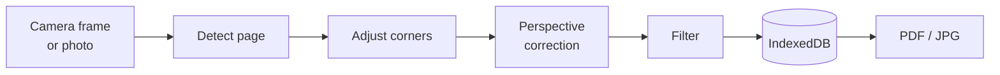

<div align="center">


# DocScan

**Scan paper documents with your camera. Straighten, clean up, and save them as PDF.**
Private by design: everything runs on your device. No ads, no tracking, and no account unless you turn on Google Drive sync.

[](https://github.com/Hafij-DEU/Scan/releases/latest)
[](https://github.com/Hafij-DEU/Scan/actions/workflows/desktop.yml)
[](LICENSE)


[**Download**](https://github.com/Hafij-DEU/Scan/releases/latest) · [Features](#features) · [Install](#install) · [How it works](#how-it-works) · [Build](#build-from-source)

</div>

<p align="center">
  
  &nbsp;
  
  &nbsp;
  
</p>
<p align="center"><sub>Your documents · automatic page detection · straightened page with filters</sub></p>

## Features

- 📷 **Capture or import**: live camera with the page outline drawn as you aim, or import photos (several at once).
- ✂️ **Automatic page detection**: the corners snap to the page. Drag them to fine-tune, with a magnifier for precision.
- 📐 **Perspective correction**: a photo taken at an angle becomes a flat, upright page.
- ✨ **Filters**: *Magic color* removes shadows and colour casts. There are also *Lighten*, *Grayscale* and *B&W*.
- 📚 **Multi-page documents**: add, reorder, re-edit, rotate and delete pages; the original photo is kept for re-cropping.
- 📁 **Save folder**: PDFs go to `Documents/DocScan` (change it in Settings). The **PDFs** tab lists the folder with thumbnails, and lets you open, share, rename and delete files.
- 🔎 **Search, sort and rename**: find scans and PDFs by name; sort by date, name, pages or size.
- 📄 **PDF options**: page size (fit, A4, Letter), image quality, and a file-name pattern with `{name}`, `{date}` and `{time}`.
- 🔤 **Text recognition (OCR)**: copy a page's text, or save *searchable* PDFs with an invisible text layer. English, fully offline.
- ✍️ **Signature**: draw it once, then drag and resize it onto any page.
- 🪪 **ID-card mode**: scan the front and back, and get both sides on one page.
- ☁️ **Google Drive sync (optional)**: keeps the save folder in step with a *DocScan* folder in your Drive, so every device you sign in on has the same PDFs as an offline copy.
- 🎨 **Themes**: light, dark or system, with five colour accents.
- 🔒 **Private**: scans stay on your device. The app goes online only for Drive sync, and only after you sign in.

<p align="center">
  
</p>

## Install

Get the files from the [latest release](https://github.com/Hafij-DEU/Scan/releases/latest).

| Platform | File | Size | Requirements |
| --- | --- | --- | --- |
| **Linux** | `DocScan-<version>-amd64.deb` | about 5 MB | Ubuntu 22.04, Debian 12 or newer, x86-64 |
| **Windows** | `DocScan-<version>-setup-x64.exe` (installer)<br>`DocScan-<version>-portable-x64.exe` (no install) | a few MB | Windows 10 or 11, x64 |
| **Android** | `DocScan-<version>.apk` | about 7 MB | Android 10 or newer |

The desktop apps use the web engine your system already has (WebKitGTK on Linux, Microsoft Edge WebView2 on Windows) instead of bundling a browser. That keeps them small and quick to start. About 6 MB of each download is the offline OCR engine, which loads only when you use text recognition.

> [!NOTE]
> **Upgrading from 0.1.x on Linux or Windows?** Version 0.2.0 replaced the desktop shell, so scans saved by 0.1.x don't show up in 0.2.0. Export the ones you want to keep as PDF before you update. On Windows, also uninstall the old *DocScan* from *Settings → Apps*; the new version installs next to it. Android is not affected.

### Linux

This command works from any folder. It downloads the package, then installs it; run it again with a newer version to update.

```bash
wget -O /tmp/DocScan.deb https://github.com/Hafij-DEU/Scan/releases/download/v0.3.0/DocScan-0.3.0-amd64.deb && sudo apt install /tmp/DocScan.deb
```

<details>
<summary>Installing a <code>.deb</code> you already downloaded</summary>

Give `apt` the file's full path. A bare file name is looked up as a package name and fails.

```bash
sudo apt install ~/Downloads/DocScan-0.3.0-amd64.deb
```

Some download managers save to `~/Downloads/Compressed/` instead.
</details>

To uninstall: `sudo apt remove docscan`.

### Windows

Run the installer, or start the portable exe without installing. The builds aren't code-signed yet, so SmartScreen may say *"Windows protected your PC"*. Choose **More info**, then **Run anyway**.

### Android

Open the APK on your phone and allow installs from your browser or file manager when asked. Updates install over the previous version and keep your scans.

<details>
<summary>Verify downloads</summary>

Each release has a `SHA256SUMS` file for the `.deb`, `.exe` and `.apk` files, and GitHub shows a SHA-256 digest for every file:

```bash
sha256sum -c SHA256SUMS --ignore-missing
```

The APK signing certificate has SHA-256 `0d5accebaeb219e5012b290a87e8ad0b672f2e22f5f85d419b370abcd7d96a50`.
</details>

## Google Drive sync

Sync is optional and off until you sign in. DocScan asks only for the `drive.file` permission: it can see the files it created, not the rest of your Drive.
Two-way sync matches files by name. New and changed PDFs are copied both ways, and a file deleted on one side is removed on the other at the next sync (in Drive it goes to the trash).

The released apps don't ship a Google API client yet, so you add your own once:

1. Open [Google Cloud Console](https://console.cloud.google.com/apis/credentials) and create a project.
2. Enable the **Google Drive API**.
3. Set up the **OAuth consent screen** (External), and add your Google account as a **test user**.
4. Create an **OAuth client ID** of type **Desktop app**.
5. In DocScan, open **Settings → Google Drive → Google API client**, paste the client ID and secret, and tap **Save client**.
6. Tap **Sign in with Google** and finish in your browser.

Use the same client on every device. Sign-in uses the loopback flow with PKCE on Linux, Windows and Android.

<details>
<summary>Building with a client built in</summary>

Set `VITE_GOOGLE_CLIENT_ID` and `VITE_GOOGLE_CLIENT_SECRET` when you run `pnpm build:web` (or any build script). The release workflow reads them from the repository secrets `GOOGLE_CLIENT_ID` and `GOOGLE_CLIENT_SECRET`. A client entered in Settings overrides the built-in one.
</details>

## How it works

All image processing is plain TypeScript running on the device. It has no OpenCV, no machine learning, and no server.



| Step | Method | Code |
| --- | --- | --- |
| Detect page | Otsu threshold, largest region with holes filled, convex hull, max-area quadrilateral. Each side must have a visible edge, so screenshots and flat scans keep the whole image. | [`detect.ts`](src/imaging/detect.ts), [`geometry.ts`](src/imaging/geometry.ts) |
| Perspective correction | 8-point homography with bilinear sampling, output up to 2480 px (about A4 at 300 dpi) | [`warp.ts`](src/imaging/warp.ts) |
| Filters | Divide by an estimated paper background (block bright-mean, dilated and smoothed), then a tone curve | [`filters.ts`](src/imaging/filters.ts) |
| PDF | Dependency-free PDF 1.4 writer, one JPEG per page, optional invisible text layer | [`pdf.ts`](src/pdf.ts) |
| OCR | [tesseract.js](https://github.com/naptha/tesseract.js) in a worker, loaded on first use from local files | [`ocr.ts`](src/ocr.ts) |
| Drive sync | Drive REST v3 with `fetch`, OAuth 2 loopback + PKCE | [`sync.ts`](src/sync.ts) |
| Storage | IndexedDB stores documents and pages, keeping originals for re-editing | [`store.ts`](src/store.ts) |

One web app (`src/`, Vite + TypeScript, about 90 KB of JavaScript) ships in two shells:

- **Linux and Windows**: a [Tauri](src-tauri/src/main.rs) shell in Rust on the system web view. Release builds run on [GitHub Actions](.github/workflows/desktop.yml).
- **Android**: a small Java [WebView host](android/app/src/main/java/io/github/hafijbge/docscan/). It serves the app from a secure origin, grants camera access, saves to the folder, and shares exports.

## Build from source

Requirements: Node.js 22+, pnpm 10 (`corepack enable`). The desktop app also needs [Rust](https://rustup.rs/) and, on Linux, `libwebkit2gtk-4.1-dev`, `libgtk-3-dev` and `librsvg2-dev`. For Android you need JDK 17, the Android SDK (platform 35) and Gradle 8.11.

```bash
pnpm install
pnpm dev         # browser preview at http://localhost:5173
pnpm start       # desktop app (Tauri, with live reload)
pnpm build:deb   # release/DocScan-<version>-amd64.deb
pnpm build:win   # release/*.exe (on Windows; CI does this for releases)
pnpm build:apk   # debug APK in android/app/build/outputs/apk/debug/
```

<details>
<summary>Android build notes</summary>

`build:apk` runs Gradle from `~/.local/opt/gradle-8.11.1` in offline mode. Set `sdk.dir` in `android/local.properties`.
For a signed release APK, set `DOCSCAN_KEYSTORE`, `DOCSCAN_KEYSTORE_PASSWORD`, `DOCSCAN_KEY_ALIAS` and `DOCSCAN_KEY_PASSWORD`, then run `gradle assembleRelease` in `android/`.
The version comes from `package.json` for every platform.
</details>

<details>
<summary>Project layout</summary>

| Path | Purpose |
| --- | --- |
| `src/imaging/` | Page detection, perspective warp, filters, image helpers |
| `src/screens/` | Home, PDFs, camera, crop, enhance, document, page, sign and settings screens |
| `src/ui/` | DOM helpers, dialogs and the screen router |
| `src/pdf.ts`, `src/store.ts`, `src/platform.ts` | PDF writer, IndexedDB storage, Android/desktop folder, save and share |
| `src/ocr.ts`, `src/sync.ts`, `src/settings.ts` | Text recognition, Google Drive sync, settings |
| `src-tauri/` | Desktop shell (Tauri, Rust) |
| `android/` | Android WebView shell (Gradle project) |
| `.github/workflows/` | Linux and Windows release builds |
| `docs/` | Screenshots and the [design notes](docs/camscanner-analysis.md) |
</details>

## Roadmap

- [x] Text recognition (OCR) and searchable PDFs
- [x] Signatures
- [x] ID-card mode (both sides on one page)
- [x] Google Drive sync
- [ ] More OCR languages
- [ ] Annotations (text, highlight)
- [ ] Signed Windows builds

## Background

DocScan is an independent, clean-room project. Its feature set was scoped from a static analysis of CamScanner ([notes](docs/camscanner-analysis.md)); no CamScanner code or assets are used.

## License

[MIT](LICENSE) © 2026 Hafij-BGE
